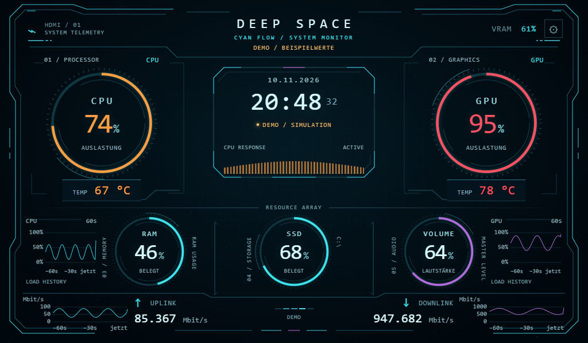

# Deep Space HUD · Cyan Flow

Animiertes PC-Statuspanel für ein **1024 × 600 HDMI-Display** unter Windows 10/11.
CPU, GPU, RAM, Laufwerksbelegung, Lautstärke, Temperaturen und Netzwerkwerte in
einer Cyan-HUD-Oberfläche. Die Animation reagiert auf die CPU-Last.

**[Windows-Paket herunterladen](https://github.com/JobbeDeluxe/deep-space-hud/raw/refs/heads/main/downloads/Deep-Space-HUD-Windows.zip)**
· [Alle Releases](https://github.com/JobbeDeluxe/deep-space-hud/releases)
· [Vollständige Anleitung](LIESMICH.md)

## Starten

1. Das Windows-Paket herunterladen und vollständig entpacken.
2. **Python 3.10 oder neuer, 64 Bit** von [python.org](https://www.python.org/downloads/windows/)
   installieren, falls es noch fehlt. Im Installer **Add python.exe to PATH** aktivieren.
3. **START.cmd** doppelklicken. Der erste Start installiert die benötigten
   Python-Bibliotheken in einer lokalen `.venv`; dafür wird Internet benötigt.
4. In Windows den Desktop auf das HDMI-Display **erweitern**, das Browserfenster
   auf dieses Display ziehen und **F** oder **F11** für Vollbild drücken.
5. Das Terminal offen lassen. Zum Beenden dort **Strg+C** drücken.

Das Panel läuft lokal unter `http://127.0.0.1:8765`. Es benötigt weder InfoPanel
noch TelemetryForge und sendet keine PC-Messwerte an einen Cloud-Dienst.

## Design ohne Installation ansehen

`Deep-Space-HUD.html` direkt im Browser öffnen. Dieser Modus zeigt deutlich
gekennzeichnete **simulierte Demowerte** und benötigt keinen Sensorservice.

| Taste | Funktion |
|---|---|
| **F** | Vollbild ein/aus |
| **S** | Einstellungen |
| **D** | Demo ein/aus |

In den Einstellungen lassen sich 10 %, 50 % und 95 % Demo-CPU-Last vergleichen,
die Effektstärke verändern und Bewegungen ausschalten.

## Sensoren

- **CPU, RAM, Laufwerk, Netzwerk:** lokale Auslesung mit `psutil`.
- **Lautstärke:** Windows-Standardausgabegerät über `pycaw`; kein Audio-Equalizer.
- **CPU-Temperatur und weitere GPU-Sensoren:**
  [LibreHardwareMonitor](https://github.com/LibreHardwareMonitor/LibreHardwareMonitor/releases)
  mit lokalem Webserver unter `http://127.0.0.1:8085/data.json`.
- **NVIDIA-Fallback:** GPU-Last, Temperatur und VRAM über `nvidia-smi`, falls LHM
  keine GPU-Werte liefert.
- Nicht verfügbare Sensoren erscheinen als **„—“**. Die SSD-Anzeige zeigt die
  Laufwerksbelegung, nicht SSD-Gesundheit oder Aktivität.

Die mittleren Balken sind eine lastabhängige Designanimation, keine einzelnen
CPU-Kerne. Die kleinen CPU-/GPU-Kurven zeigen den Verlauf der Messwerte.

## Konfiguration und Prüfung

Laufwerk, Netzwerkadapter, Ports und Sensorzuordnung stehen in `config.json`.
Details und Fehlerhilfe findest du in [LIESMICH.md](LIESMICH.md).

Browserfunktionen, Skalierung, Lastreaktion, Sensorparser und Ausfallverhalten
wurden unter Linux geprüft. Die konkrete Windows-Hardware, CoreAudio und der
Windows-Erststart sind noch nicht auf einem echten Windows-PC getestet.
Siehe [PRUEFUNG.txt](PRUEFUNG.txt).
