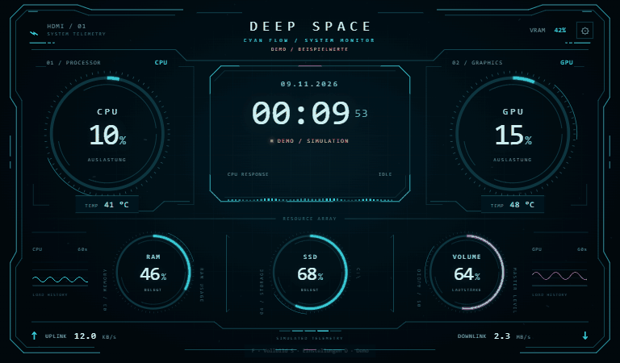

# Deep Space HUD · Cyan Flow

Animiertes PC-Statuspanel für ein **1024 × 600 HDMI-Display** unter Windows 10/11.
CPU, GPU, RAM, Laufwerksbelegung, Lautstärke, Temperaturen und Netzwerkwerte in
einer Cyan-HUD-Oberfläche mit dezentem Sternenflug / Warp-Hintergrund.
Sterne, CPU-Wellen und Ringmarkierungen reagieren auf die Systemlast.

**A local Windows hardware monitor and sci-fi sensor panel for 1024 × 600 HDMI
displays. CPU/GPU usage and temperatures, RAM, VRAM, storage, volume and network
telemetry — with a subtle load-reactive starfield, configurable warning colors
and a browser-based HUD.**

**[Windows-Paket herunterladen](https://github.com/JobbeDeluxe/deep-space-hud/raw/refs/heads/main/downloads/Deep-Space-HUD-Windows.zip)**
· [Alle Releases](https://github.com/JobbeDeluxe/deep-space-hud/releases)
· [Vollständige Anleitung](LIESMICH.md)

*24-Sekunden-Demo: niedrige Last, längere orange Phase bei 74 %, hohe Last
und zurück. Sternenflug, Warnfarben und beschriftete Verlaufskurven.
Alle Messwerte im GIF sind simuliert.*
[Statische Vorschau](VORSCHAU-DEMO.png) · [Deutsche Anleitung](LIESMICH.md)

## Starten

1. Das Windows-Paket herunterladen und vollständig entpacken.
2. **Python 3.10 oder neuer, 64 Bit** von [python.org](https://www.python.org/downloads/windows/)
   installieren, falls es noch fehlt. Im Installer **Add python.exe to PATH** aktivieren.
3. **START.cmd** doppelklicken. Der erste Start installiert die benötigten
   Python-Bibliotheken in einer lokalen `.venv`; dafür wird Internet benötigt.
4. In Windows den Desktop auf das HDMI-Display **erweitern**, das Browserfenster
   auf dieses Display ziehen und **F** oder **F11** für Vollbild drücken.
5. Das Terminal offen lassen. Zum Beenden dort **Strg+C** drücken.

Das Panel läuft lokal unter `http://127.0.0.1:8765`. Es benötigt weder InfoPanel
noch TelemetryForge und sendet keine PC-Messwerte an einen Cloud-Dienst.

## Design ohne Installation ansehen

`Deep-Space-HUD.html` direkt im Browser öffnen. Dieser Modus zeigt deutlich
gekennzeichnete **simulierte Demowerte** und benötigt keinen Sensorservice.

| Taste | Funktion |
|---|---|
| **F** | Vollbild ein/aus |
| **S** | Einstellungen |
| **D** | Demo ein/aus |

In den Einstellungen lassen sich 10 %, 50 % und 95 % Demo-CPU-Last vergleichen,
die Effektstärke verändern und Bewegungen ausschalten.

## Netzwerk und Verlaufskurven

Im Setup lassen sich **KB/s, MB/s, GB/s oder Automatik** auswählen; Standard
ist **MB/s**. Es sind dezimale **Byte pro Sekunde**, keine Bit/s.
Upload und Download haben eigene Verlaufskurven neben den aktuellen Werten.
Die jeweilige Höhenskala richtet sich nach dem größten Wert im sichtbaren
Zeitraum und trägt Zahlen samt Einheit.

Alle vier Kurven zeigen die **letzten 60 Sekunden** mit „−60s“, „−30s“ und
„jetzt“. CPU und GPU haben eine feste **0 / 50 / 100 %**-Skala. Datenlücken
werden nicht verbunden; beim Demo-Wechsel werden die Verläufe zurückgesetzt.

## Sternenflug im Hintergrund

Dezente Sterne ziehen perspektivisch am HUD vorbei. Bei höherer CPU-Last fliegen
sie schneller und ziehen längere Spuren; die Messwerte bleiben im Vordergrund.
Unter **S / Zahnrad** lassen sich der Sternenflug ausschalten und seine
Sichtbarkeit regeln. **Bewegung aus** stoppt auch den Sternenflug.
Die Einstellung für reduzierte Bewegung wird beim ersten Start berücksichtigt.

## Neu in v1.1.0

- CPU- und GPU-Markierungen bewegen sich frei und unabhängig mit sanften,
  zufälligen Tempo- und Richtungswechseln. Höhere jeweilige Last erhöht das Tempo.
- Große Lastsprünge werden schnell übernommen; kleine Schwankungen bleiben ruhig.
- Die CPU-Wellen werden bei hoher Last höher und schneller.
- Zahlen, Auslastungsringe und CPU-Wellen verwenden einstellbare Warnfarben:

| Werte | Orange ab | Rot ab |
|---|---|---|
| CPU-/GPU-Temperatur | 65 °C | 75 °C |
| Alle Prozentwerte, einschließlich VRAM und Lautstärke | 70 % | 80 % |

Mit **S** oder dem Zahnrad lassen sich Grenzwerte, Bewegungsglättung und
Animationstempo ändern. Einstellungen bleiben im jeweiligen Browser gespeichert.
Details: [Änderungsverlauf](CHANGELOG.md).

## Sensoren

- **CPU, RAM, Laufwerk, Netzwerk:** lokale Auslesung mit `psutil`.
- **Lautstärke:** Windows-Standardausgabegerät über `pycaw`; kein Audio-Equalizer.
- **CPU-Temperatur und weitere GPU-Sensoren:**
  [LibreHardwareMonitor](https://github.com/LibreHardwareMonitor/LibreHardwareMonitor/releases)
  mit lokalem Webserver unter `http://127.0.0.1:8085/data.json`.
- **NVIDIA-Fallback:** GPU-Last, Temperatur und VRAM über `nvidia-smi`, falls LHM
  keine GPU-Werte liefert.
- Nicht verfügbare Sensoren erscheinen als **„—“**. Die SSD-Anzeige zeigt die
  Laufwerksbelegung, nicht SSD-Gesundheit oder Aktivität.

Die mittleren Balken sind eine lastabhängige Designanimation, keine einzelnen
CPU-Kerne. Die kleinen CPU-/GPU-Kurven zeigen den Verlauf der Messwerte.

## Konfiguration und Prüfung

Laufwerk, Netzwerkadapter, Ports und Sensorzuordnung stehen in `config.json`.
Details und Fehlerhilfe findest du in [LIESMICH.md](LIESMICH.md).

Die ursprünglichen Browser-, Parser- und Ausfalltests wurden unter Linux ausgeführt.
v1.1.0 wurde zusätzlich unter Windows mit Chrome/Playwright geprüft. CPU-, GPU-,
Temperatur- und Lautstärkewerte wurden auf einem Windows-PC live empfangen.
Eine frische Python-Erstinstallation und weitere Hardwaremodelle sind nicht geprüft.
Siehe [PRUEFUNG.txt](PRUEFUNG.txt).
