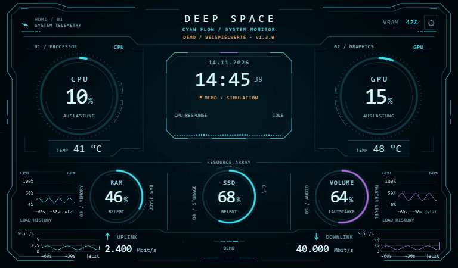
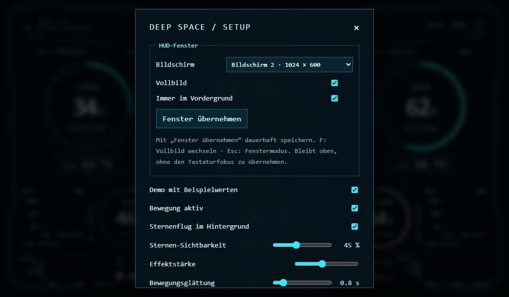

# Deep Space HUD · Cyan Flow · v1.3.0

Animiertes PC-Statuspanel für ein **1024 × 600 HDMI-Display** unter Windows 10/11.
CPU, GPU, RAM, Laufwerksbelegung, Lautstärke, Temperaturen und Netzwerkwerte in
einer Cyan-HUD-Oberfläche mit dezentem Sternenflug / Warp-Hintergrund.
Sterne, CPU-Wellen und Ringmarkierungen reagieren auf die Systemlast.

**A local Windows hardware monitor and sci-fi sensor panel for 1024 × 600 HDMI
displays. CPU/GPU usage and temperatures, RAM, VRAM, storage, volume and network
telemetry — with a subtle load-reactive starfield, configurable warning colors
and a browser-based HUD.**

**[Windows-Paket herunterladen](https://github.com/JobbeDeluxe/deep-space-hud/raw/refs/heads/main/downloads/Deep-Space-HUD-Windows.zip)**
· [Alle Releases](https://github.com/JobbeDeluxe/deep-space-hud/releases)
· [Vollständige Anleitung](LIESMICH.md)

*24-Sekunden-Demo: niedrige Last, längere orange Phase bei 74 %, hohe Last
und zurück. Sternenflug, Warnfarben und beschriftete Verlaufskurven.
Alle Messwerte im GIF sind simuliert.*
[Statische Vorschau](VORSCHAU-DEMO.png) · [Deutsche Anleitung](LIESMICH.md)

## Neu in v1.3.0: fester Bildschirm, Vollbild und Start ohne Konsole

Das HUD lässt sich dauerhaft einem Bildschirm zuordnen und im Vollbild
**immer im Vordergrund** anzeigen. Die Optionen stehen direkt unter
**S → HUD-Fenster**. **START-OHNE-KONSOLE.vbs** startet ohne sichtbares CMD-Fenster;
**HUD beenden** oder **Alt+F4** beendet auch den Sensorserver.

## Lesbarkeit am HDMI-Display

Temperaturen und Netzwerkwerte sind jetzt **22 px** groß. Netzwerkbezeichnung
und Messwert stehen auf zwei Zeilen; die Verlaufskurven bleiben jeweils außen.
Der Downlink-Block sitzt rechtsbündig direkt neben seiner Verlaufsskala.
Größere, kontrastreichere Beschriftungen, Skalen und Setup-Texte erleichtern das
Ablesen auf kleinen Displays. Der Uhrkasten ist kompakter (280 × 192 px),
die Uhrzeit etwas kleiner. Das Layout bleibt auf **1024 × 600** abgestimmt.

## Starten

1. Das Windows-Paket herunterladen und vollständig entpacken.
2. **Python 3.10 oder neuer, 64 Bit** von [python.org](https://www.python.org/downloads/windows/)
   installieren, falls es noch fehlt. Im Installer **Add python.exe to PATH** aktivieren.
3. **START-OHNE-KONSOLE.vbs** doppelklicken. Der erste Start installiert die benötigten
   Python-Bibliotheken in einer lokalen `.venv`; dafür wird Internet benötigt.
   Chrome oder Edge öffnet ein eigenes HUD-Fenster für den Hintergrundbetrieb.
4. In Windows den Desktop auf das HDMI-Display **erweitern**. Im HUD mit **S**
   das Setup öffnen und unter **HUD-Fenster** Bildschirm, Vollbild und
   **Immer im Vordergrund** auswählen. **Fenster übernehmen** speichert die Auswahl.
5. Beenden über **S → HUD beenden** oder **Alt+F4** im HUD-Fenster. Der lokale
   Sensorserver beendet sich ebenfalls; es bleibt kein CMD-Fenster offen.

**START.cmd** bleibt als Variante mit sichtbarer Diagnosekonsole verfügbar.
Falls Windows Script Host deaktiviert ist, kann auch **launch.pyw** mit Python
gestartet werden. Fehlermeldungen stehen in `launch.log` beziehungsweise `hud.log`.

### Fensteroptionen

Vollbild und Vordergrundmodus sind beim ersten Start eingeschaltet. Der zunächst
verwendete Bildschirm wird gespeichert; im Setup kann ein anderer gewählt werden.
Die Auswahl bleibt in `window-settings.json` im HUD-Ordner erhalten. Fehlt der
Bildschirm vorübergehend, nutzt das HUD den Hauptbildschirm und kehrt bei erneuter
Verbindung zum gewählten Bildschirm zurück. **F/F11** wechseln Vollbild; **Esc**
verlässt Vollbild, wenn das Setup geschlossen ist. Der Vordergrundmodus ändert
die Fensterreihenfolge, ohne ständig den Tastaturfokus zu übernehmen.

„Immer im Vordergrund“ gilt für normale Desktop-Fenster. Exklusives Spiele-Vollbild
und Windows-Sicherheitsbildschirme können darüber liegen; neben Spielen das HUD
auf dem eigenen HDMI-Display betreiben. Ein erneuter Start zeigt das bereits
laufende HUD, statt einen zweiten Sensorserver zu starten.

Das Panel läuft lokal unter `http://127.0.0.1:8765`. Es benötigt weder InfoPanel
noch TelemetryForge und sendet keine PC-Messwerte an einen Cloud-Dienst.

## Design ohne Installation ansehen

`Deep-Space-HUD.html` direkt im Browser öffnen. Dieser Modus zeigt deutlich
gekennzeichnete **simulierte Demowerte** und benötigt keinen Sensorservice.

| Taste | Funktion |
|---|---|
| **F** | Vollbild ein/aus |
| **S** | Einstellungen |
| **D** | Demo ein/aus |

In den Einstellungen lassen sich 10 %, 50 % und 95 % Demo-CPU-Last vergleichen,
die Effektstärke verändern und Bewegungen ausschalten.

## Hintergrundbetrieb

**Für das HDMI-Display neben einem Spiel: `START-OHNE-KONSOLE.vbs` verwenden.**
Der Starter öffnet ein eigenes Chrome-/Edge-Fenster mit separatem HUD-Profil. In diesem
Profil sind Energie-/Speichersparen und automatisches Einfrieren bei der ersten
Einrichtung deaktiviert; Startparameter verhindern die Timerdrosselung und
Hintergrundbehandlung verdeckter Fenster. Das normale Browserprofil wird nicht
verändert. Die HUD-Einstellungen im neuen Profil einmal neu setzen; anschließend
bleiben sie dort gespeichert. `START-BROWSER.cmd` öffnet weiterhin den normalen
Standardbrowser, dessen Hintergrundregeln dann gelten. Ohne Chrome/Edge wird
ebenfalls auf den Standardbrowser zurückgegriffen.

Der Python-Sensorserver sammelt CPU, GPU, Upload und Download weiter, auch wenn
das Browserfenster keinen Fokus hat oder der Tab im Hintergrund liegt. Die
letzten **60 Sekunden** werden im Server gehalten und als Live-Datenstrom an
das HUD geschickt. Beim Zurückwechseln werden Messwerte und Verlauf nachgeladen.
Ein vom Browser vollständig eingefrorener Tab kann vorübergehend nicht zeichnen;
die währenddessen im Server gemessenen Punkte gehen dadurch nicht verloren.
Der Sensorserver muss dafür weiterlaufen. Echte Sensor- oder Serverausfälle
bleiben als fehlende Werte beziehungsweise Datenlücken erkennbar.
Die Windows-Lautstärkeabfrage läuft getrennt und kann die CPU-/Netzwerk-Messung
nicht mehr aufhalten. Abgebrochene Browserverbindungen, einschließlich
`WinError 10053`, werden ohne Traceback beendet.

## Netzwerk und Verlaufskurven

Standard sind **Mbit/s mit drei Nachkommastellen**, wie bei Internetleitungen.
Im Setup bleiben **kbit/s, Mbit/s, Gbit/s, KB/s, MB/s, GB/s** sowie getrennte
Automatikmodi für Bit/s und Byte/s auswählbar. **1 MB/s = 8 Mbit/s**.
Die Anzeige misst den tatsächlichen Datenverkehr, nicht die maximale Leitungsrate.
Beim Update auf v1.2.0 wird Mbit/s einmalig aktiviert; spätere Auswahlen bleiben
gespeichert.
Upload und Download haben eigene Verlaufskurven neben den aktuellen Werten.
Die Uplink-Kurve steht links außen, Pfeil und Messwert folgen rechts daneben.
Die Höhenskala trägt Zahlen samt Einheit. Im Setup kannst du zwischen
**automatischer Skalierung** und **festen Upload-/Download-Maximalwerten** wählen.
Trage bei „Fest“ die Bandbreite deiner Leitung ein: Der obere Rand bleibt dann
konstant. Die Vorgaben 100 / 1000 Mbit/s sind Beispiele. Werte darüber werden
am oberen Rand mit ↑ markiert; ein Einheitenwechsel rechnet die Grenzen um.

Alle vier Kurven zeigen die **letzten 60 Sekunden** mit „−60s“, „−30s“ und
„jetzt“. CPU und GPU haben eine feste **0 / 50 / 100 %**-Skala. Datenlücken
werden nicht verbunden; beim Demo-Wechsel werden die Verläufe zurückgesetzt.

## Ringbewegung einstellen

Unter **S → Ring-Drehrichtung**: regelmäßig wechselnd (Standard), zufällig,
nur rechtsherum oder nur linksherum. Das gilt für alle fünf Markierungen.
Das Wechselintervall lässt sich von **1 bis 15 Sekunden** einstellen (Standard
4 Sekunden, leicht zeitversetzt mit ±25 %). Richtungswechsel werden weich
überblendet; die CPU-/GPU-Last steuert weiterhin das Tempo.

## Sternenflug im Hintergrund

Dezente Sterne ziehen perspektivisch am HUD vorbei. Bei höherer CPU-Last fliegen
sie schneller und ziehen längere Spuren; die Messwerte bleiben im Vordergrund.
Unter **S / Zahnrad** lassen sich der Sternenflug ausschalten und seine
Sichtbarkeit regeln. **Bewegung aus** stoppt auch den Sternenflug.
Die Einstellung für reduzierte Bewegung wird beim ersten Start berücksichtigt.

## Neu in v1.1.0

- CPU- und GPU-Markierungen bewegen sich frei und unabhängig mit sanften,
  zufälligen Tempo- und Richtungswechseln. Höhere jeweilige Last erhöht das Tempo.
- Große Lastsprünge werden schnell übernommen; kleine Schwankungen bleiben ruhig.
- Die CPU-Wellen werden bei hoher Last höher und schneller.
- Zahlen, Auslastungsringe und CPU-Wellen verwenden einstellbare Warnfarben:

| Werte | Orange ab | Rot ab |
|---|---|---|
| CPU-/GPU-Temperatur | 65 °C | 75 °C |
| Alle Prozentwerte, einschließlich VRAM und Lautstärke | 70 % | 80 % |

Mit **S** oder dem Zahnrad lassen sich Grenzwerte, Bewegungsglättung und
Animationstempo ändern. Einstellungen bleiben im jeweiligen Browser gespeichert.
Details: [Änderungsverlauf](CHANGELOG.md).

## Sensoren

- **CPU, RAM, Laufwerk, Netzwerk:** lokale Auslesung mit `psutil`.
- **Lautstärke:** Windows-Standardausgabegerät über `pycaw`; kein Audio-Equalizer.
- **CPU-Temperatur und weitere GPU-Sensoren:**
  [LibreHardwareMonitor](https://github.com/LibreHardwareMonitor/LibreHardwareMonitor/releases)
  mit lokalem Webserver unter `http://127.0.0.1:8085/data.json`.
- **NVIDIA-Fallback:** GPU-Last, Temperatur und VRAM über `nvidia-smi`, falls LHM
  keine GPU-Werte liefert.
- Nicht verfügbare Sensoren erscheinen als **„—“**. Die SSD-Anzeige zeigt die
  Laufwerksbelegung, nicht SSD-Gesundheit oder Aktivität.

Die mittleren Balken sind eine lastabhängige Designanimation, keine einzelnen
CPU-Kerne. Die kleinen CPU-/GPU-Kurven zeigen den Verlauf der Messwerte.

## Konfiguration und Prüfung

Laufwerk, Netzwerkadapter, Ports und Sensorzuordnung stehen in `config.json`.
Details und Fehlerhilfe findest du in [LIESMICH.md](LIESMICH.md).

Die ursprünglichen Browser-, Parser- und Ausfalltests wurden unter Linux ausgeführt.
v1.1.0 wurde zusätzlich unter Windows mit Chrome/Playwright geprüft. CPU-, GPU-,
Temperatur- und Lautstärkewerte wurden auf einem Windows-PC live empfangen.
Eine frische Python-Erstinstallation und weitere Hardwaremodelle sind nicht geprüft.
Siehe [PRUEFUNG.txt](PRUEFUNG.txt).
